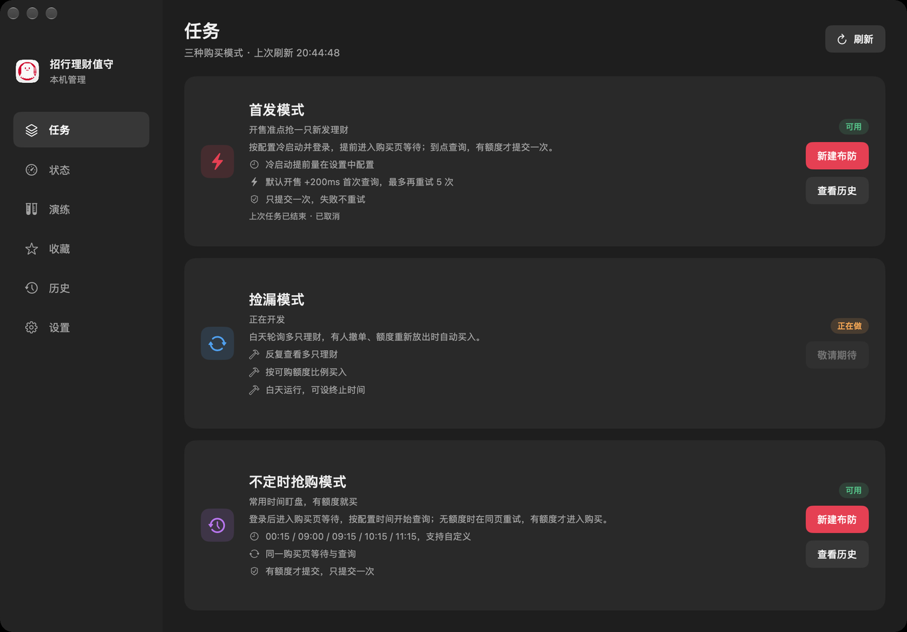
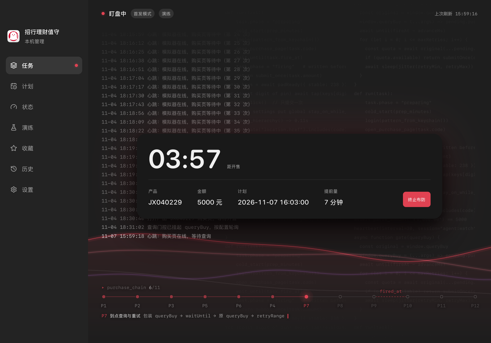
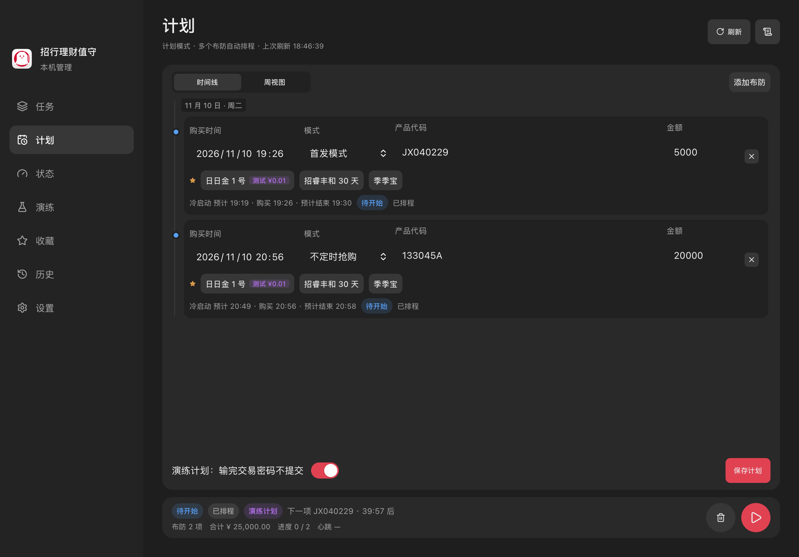
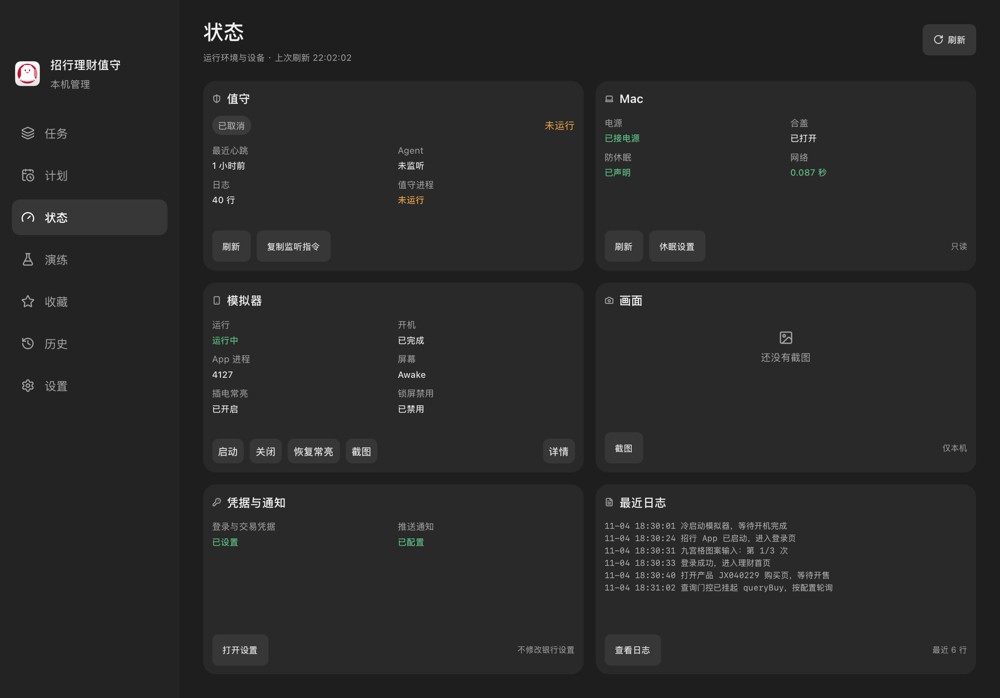
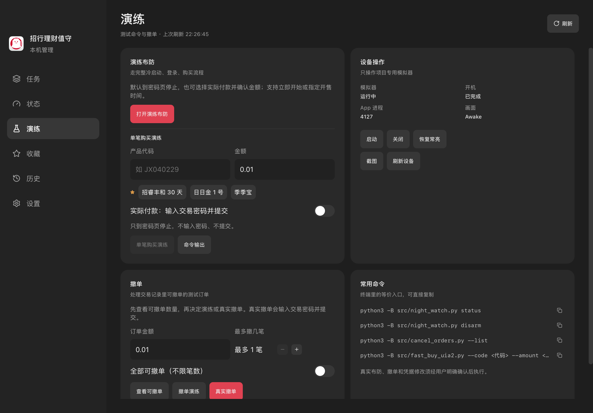
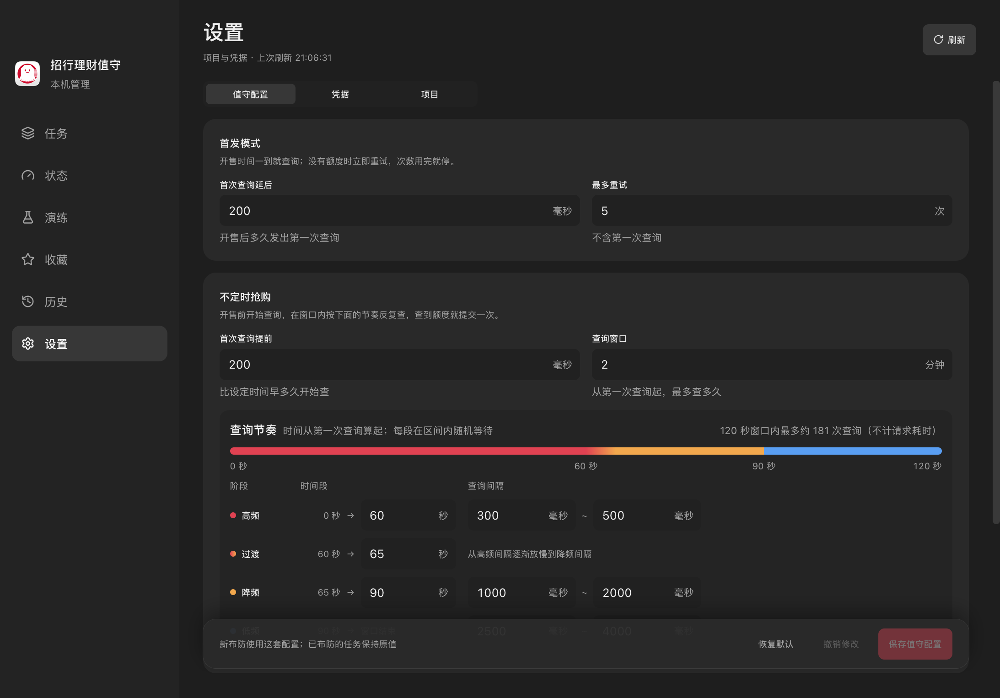
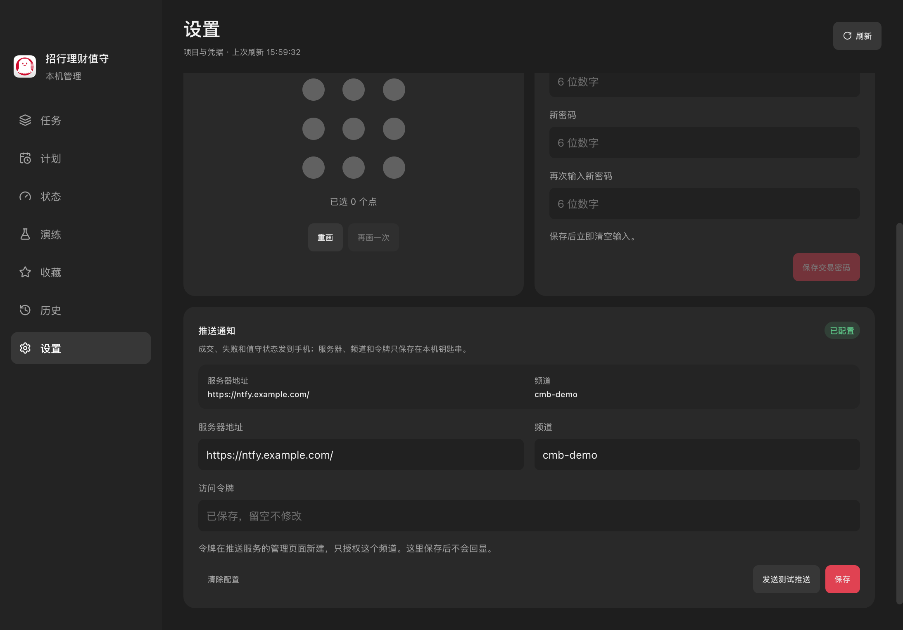
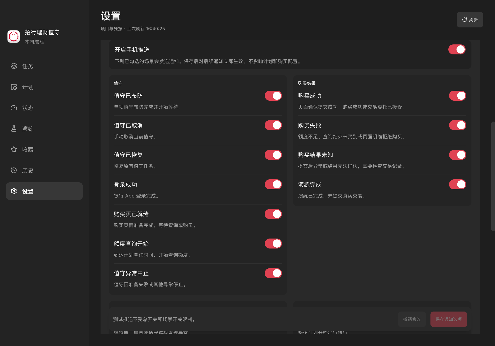

# 自用招行理财脚本

在本机 Android 模拟器里运行招商银行 App，按指定的产品、金额和时间自动买理财。只供账户持有人自己使用。

> 这是个人自动化脚本，不是银行接口。默认沿用 App 原有流程；如需绕过安全机制，必须先向用户说明具体方式及影响，并取得用户明确确认后才能执行。一笔只提交一次。结果以银行交易记录和产品管理机构的确认为准。

## 模式

| 模式 | 状态 | 一句话 |
|---|---|---|
| 首发模式 | 🧪 新流程待实战 | 提前进入购买页，开售后按配置开始查询 |
| 不定时抢购模式 | 🧪 已实现，待新版实战验证 | 常用时间或自定义时间盯住一只理财，有额度就买 |
| 计划模式 | 🧪 已实现，待实战验证 | 一次设定多个购买时间，程序自动排程并串行布防 |
| 捡漏模式 | 📝 规划中 | 白天轮询多只理财，有人撤单就买 |

布防和计划里的购买金额都**没有上限**：大于 0、最多两位小数，填多少购买页就填多少；程序不预判账户余额是否足够，责任在用户。

### 首发模式

- 每次只买一只理财，金额固定。开始时间默认 09:00。
- 默认提前 **7 分钟**冷启动 App 并登录，随后进入隔离的购买页；`queryBuy` 挂起，开始前不发该查询。
- 默认在设定时间 **+200ms** 首次调用页面原始 `queryBuy`。明确无额度就立即串行重试，默认首次之外最多再重试 **5 次**（最多 6 次查询），不重新打开购买页。
- 成功结果交回银行页面，表单就绪并校验产品、金额、原始产品额度后，通过原 JS 组件完成风险资料加载与文本确认，再进入密码 → 确定，只提交一次。其他拒绝、查询超时或初始化拦截失败则停止。
- E（冷启动提前分钟数）、N（延后毫秒数）、M（额外重试次数）统一在管理 App「设置 → 值守配置」修改；布防只选产品、金额、时间并查看当前配置。
- E 可选 **「立即」**：布防后马上冷启动、登录并进入购买页，再等到开售时间购买；不校验剩余时间够不够。冷启动前必先确认模拟器能出网。

**验证**：新流程已通过隔离测试及模拟器初始化挂起检查，尚待正式窗口验收。过去约 4 秒完成交易的实战结果属于旧的到点打开购买页流程，不能代表新流程已实战通过。

**命令**（用户确认后执行，可由 Agent 运行）：

```sh
python3 -B src/night_watch.py arm --code <产品代码> --amount <金额> --at 2026-11-05T09:00:00
python3 -B src/night_watch.py status
python3 -B src/night_watch.py disarm
```

`--at` 填名义开售时间，延后由配置计算；新任务快照保存配置。首次使用先加 `--dry-run`。

### 不定时抢购模式

**背景**：每天 00:15、09:00、09:15、10:15、11:15 左右可能放出额度，不保证准时。管理 App 新建布防可选这些时间或自定义时间，默认选择最近且留足准备时间的一档。额度没放出时打开购买页，App 会直接跳到"购买失败 / 额度不足"页；页面出现购买表单，就说明有额度了。

**行为**：

- 只盯一只产品，金额固定。默认提前 **7 分钟**冷启动、登录并进入购买页，挂起首个 `queryBuy`。
- 默认在设定时间 **前 200ms** 开始查询。明确无额度时，不让结果触发换页，在同一页面分段随机等待后再次调用原始页面查询：前 60 秒 **300–500ms**，60–65 秒逐渐放慢，65–90 秒 1–2 秒，之后 2.5–4 秒。
- 默认查询窗口 **2 分钟**，从首次计划查询时间算起；不会重叠发起查询，窗口到期不再接收迟到结果。每次查询仍有网络耗时，分段间隔都是响应后的等待时间。
- 有额度候选仍须等原页面的正常表单就绪；原始产品额度低于布防金额则停止，不降额、不继续重试。缺少额度字段表示未知，不按零处理。
- 设置页统一配置 E（提前冷启动分钟数）、N（首次查询提前毫秒数）、M（窗口分钟数）、R1/R2 及各分段时长与间隔（随机等待上下限）。新建布防提供五档常用时间或自定义，并显示配置摘要。
- 顶部半透明黑底气泡按文字自适应宽度，常驻显示脚本状态、开始前倒计时及累计查询次数；不定时查询开始后显示剩余窗口。

**命令**（用户确认后执行，可由 Agent 运行）：

```sh
python3 -B src/night_watch.py arm --mode redemption --code <产品代码> --amount <金额> \
    --at 2026-11-05T09:15:00
```

内部模式值保留 `redemption`，兼容旧记录。CLI 仍可指定 `--prep-minutes`、`--window-minutes` 或 `--until`；管理 App 布防不再提供这些详细设置。`--dry-run` 输完交易密码、不点确定、不提交。金额仍须满足产品单笔下限。

### 计划模式

一次设置多个布防（每项：购买时间 + 首发/不定时抢购 + 产品 + 金额），程序按**购买时间**自动倒推每项的冷启动时间，并串行执行；同一时刻仍只有一份值守、一笔一次提交。

- 用户只填购买时间；冷启动时间由程序用当前配置的提前分钟数自动计算，「计划」页会显示每项的冷启动、购买和预计结束时间。提前量为「立即」或剩余时间不足时，显示「开始后立即准备」，并在执行后显示实际冷启动时间。
- 严格串行：上一项结束（成功或失败）后才开始下一项。相邻两项间隔不足（上一项结束 + 2 分钟 + 下一项冷启动）时，保存后不能开始，页面给出至少需要的间隔分钟数。
- 购买时间须在未来 14 天内、最多 20 项；计划开始后不能修改，只能取消。
- 开始前确认：确认框列出全部产品、金额、模式与完整购买日期时间；真实计划必须勾选核对合计金额。开始请求绑定计划 ID、内容版本和配置版本，确认后任一变化都会拒绝开始，须重新核对；CLI 从 `plan` 响应读取 `plan.plan_id`、`plan.content_revision` 与顶层 `settings_revision`，明确传入开始命令。演练计划只输交易密码、不点确定、不提交。
- 某项明确失败（含准备失败、窗口内没买到、页面明确购买失败）会记为失败并继续下一项；用户手动取消当前布防则整份计划停止。提交后异常、结果无法确认或提交进程消失均记为结果未知，整份计划停止并提示先查交易记录，禁止补单或重试。取消只清理本计划所属任务，不影响并发新建的独立任务。计划开始时会快照当时的购买配置；运行期间修改配置，若当前项还没进入提交，会中止计划并取消当前布防；已进入提交则等结果，并在下一项布防前停止。最后一项不再检查配置，计划按开始时的快照完成。
- 「计划」页提供「时间线」和「周视图」：时间线连续展示所有任务，任务多时纵向滚动；周视图以今天为首日横向展示 7 天，左右切换查看全部时间段，不出现滚动条。状态统一为「主状态 · 副状态 · 描述」，主状态决定颜色；计划时间已过且未在应用运行期间执行显示「已过期」。
- 状态在 `var/night/plan.json`，计划日志在 `var/night/plan.log`；「计划」页显示每项状态、倒计时和最近日志。计划结束后保留逐项状态、原因和实际时间，可一键「编辑 / 复制为新计划」；心跳超时只告警，不自动重试交易。

**命令**（用户确认后执行，可由 Agent 运行）：

```sh
python3 -B src/admin_cli.py plan          # 查看计划
python3 -B src/admin_cli.py plan-start --plan-id <计划ID> --content-revision <内容版本> \
    --settings-revision <配置版本> --confirm-real-payment   # 真实计划须先经用户确认
python3 -B src/admin_cli.py plan-disarm   # 取消计划并停止当前布防
```

### 捡漏模式（规划中）

**背景**：9:00 首发额度抢完后，当天 17:00 前如果有人撤单，额度会重新放出，还有机会捡漏。

**设想**：

- 没有固定时间，立即启动；默认运行 1 小时，可设置终止时间。
- 支持多只理财，在各自的购买页之间轮流查看是否可购买，可以买就买入。
- 金额为当前理财余额（可购额度）的 X%，且不超过 Y 元。

## 能力

| 能力 | 说明 | 入口 |
|---|---|---|
| 值守布防 | 定时冷启动、登录、提前进入购买页挂起查询；按配置在同页查询后购买一次；状态机防重复提交；夜里看护模拟器 | `src/night_watch.py` |
| 计划模式 | 多个布防按购买时间自动排程，逐项串行执行；计划页保存/开始/取消并查看每项状态 | `src/watch_plan.py`、管理 App「计划」页 |
| 单笔购买 | 立即或定时买一笔，可 dry-run | `src/fast_buy_uia2.py` |
| 连续购买测速 | 连续 N 笔 0.01 元，逐步计时 | `src/buy_timed.py` |
| 批量撤单 | 从交易记录逐笔撤销可撤单的订单 | `src/cancel_orders.py` |
| 自动登录 | 九宫格图案存在 macOS 钥匙串，最多试 3 次防锁定 | `src/secure_input.py`、`src/keychain_store.py` |
| 手机推送 | 可选，ntfy（任意自建或公共服务器），发时间线、状态和管理 App 启动/退出；在管理 App「设置 → 推送通知」配置 | `src/push.py` |
| 管理 App | 前台窗口、状态、布防、凭据同步 | `desktop/`、`src/admin_server.py`、`src/admin_cli.py` |
| Agent 监听 | 心跳、故障通知、提交前按原任务恢复 | `skills/cmb-watch/SKILL.md` |
| 模拟器管理 | 启动 / 停止 / 状态、截图 | `scripts/project`、`scripts/capture` |

所有会提交的流程都支持 `--dry-run`：购买演练会在进程内读取交易密码并输完，停在「确定」前，不提交，结束后关闭密码框（撤单演练仍只到密码面板、不输密码）。共用购买流程已接入 JS 风险确认：保留银行预检查、风险资料查询、原组件文本校验和留痕，用原组件处理器代替动画与控件查找；新协议卡或额外资金确认等未验证分支停止，不自动跳过或回退重试。

## 架构

```
 Mac (caffeinate 防休眠)
 ├─ watch_plan.py ── 计划模式：多布防串行排程，逐项调用 night_watch.arm_task
 │     │                状态写在 var/night/plan.json
 ├─ night_watch.py ── 调度与状态机：armed → preparing → firing → done
 │     │                状态写在 var/night/task.json，进程重启也不会重复提交
 │     ├─ manage.py ─────────── 项目专用模拟器与 ADB（端口 15554 / 15039）
 │     ├─ secure_input.py ───── 九宫格登录（图案取自 macOS 钥匙串）
 │     ├─ query_gate.py / .js ── 提前进入购买页，挂起首个查询并在同页串行轮询
│     ├─ fast_buy_uia2.py ──── 打开购买页 / 接入已准备表单 → 风险弹窗 → 密码 → 确定
 │     └─ push.py ───────────── 手机推送（可选）
 │
 └─ Android 模拟器 (Google APIs arm64, 320×640)
       └─ 招行 App
            ├─ cmbmobilebank:// 链接 ── 直接打开详情页 / 购买页
            ├─ UiAutomator2 ─────────── 读控件树（约 0.11 秒/次）、点击
            └─ WebView CDP ──────────── 确认前台页面的产品代码、执行页面脚本
```

几个关键设计：

- **提前进入购买页并挂起查询**。新值守先创建隔离容器、安装预加载钩子，再导航到目标购买页；页面初始化时拦住 `queryBuy`，到配置时间才调用原函数。旧单笔购买仍可用 App 链接直达并在表单前重开。
- **控件树优先于截图**。用 UiAutomator2 读控件树判断页面和定位按钮；系统自带的 `uiautomator dump` 在有动画的页面上会失败，只作兜底。按文字定位元素，不用固定坐标。
- **双重校验**。控件树看不出是哪个产品，所以再用 CDP 读前台 WebView 地址里的产品代码；金额解析成数值比较（`￥5,000.00` = 5000）。
- **一笔只提交一次**。进入提交前先把状态写成 `firing`；结果不明时停下等人工查交易记录，绝不重试。
- **保留页面原交易流程**。值守只拦截页面的 `queryBuy` 并调用其原函数，不自行构造或重放 HTTP 请求；实际购买逻辑不加入重试。
- **计划只做排程**。计划进程只按购买时间串行调用原有 `arm`，每一项仍走同一套冷启动、查询、一次提交和状态机，没有第二套购买代码。

## 目录

```
scripts/project      模拟器启动 / 停止 / 状态 / 创建虚拟设备
scripts/capture      截取当前模拟器画面到 var/screenshots/current.png
src/                 代码（见上方"能力"）
desktop/             管理 App：Tauri 壳 + React 前端
tests/               单元测试
config/example.json  交易配置示例（不含密码）
AGENT_WORKFLOW.md    操作手册：每个流程的步骤、日志含义、失败处理和技术结论
var/                 SDK、虚拟设备、日志、运行状态（Git 忽略，含账户数据）
```

`src/run_task.py`、`src/timed_buy.py` 是早期实验路径，已不再使用；`src/stress_buy.py` 是真实压测，慎用。

## 环境准备

需要 macOS Apple Silicon、Python 3、Java 17+，以及 Google 官方 Android SDK 命令行工具。可以把 JDK 放在 `var/amazon-corretto-21.jdk`，无须装到系统。

1. 从 [Android Studio 官方下载页](https://developer.android.com/studio)下载 Mac ARM 的 Command line tools，把压缩包里 `cmdline-tools` 的内容放到 `var/android-sdk/cmdline-tools/latest/`（确保有 `bin/sdkmanager`）。也可以设置 `ANDROID_SDK_ROOT` 使用已有 SDK。
2. 接受许可并安装组件、创建虚拟设备：

   ```sh
   export ANDROID_SDK_ROOT="$PWD/var/android-sdk"
   export JAVA_HOME="$PWD/var/amazon-corretto-21.jdk/Contents/Home"
   "$ANDROID_SDK_ROOT/cmdline-tools/latest/bin/sdkmanager" --sdk_root="$ANDROID_SDK_ROOT" --licenses
   "$ANDROID_SDK_ROOT/cmdline-tools/latest/bin/sdkmanager" --sdk_root="$ANDROID_SDK_ROOT" 'platform-tools' 'emulator' 'system-images;android-35;google_apis;arm64-v8a'
   ./scripts/project create-avd
   ```

3. `./scripts/project start` 启动，`status` 查看，`stop` 关闭。模拟器用端口 15554/15555，专用 ADB 服务用 15039，端口被占用时不会启动；不碰其他 ADB 服务或模拟器。日志在 `var/emulator.log`。
4. 在模拟器里安装招行 App 并手动登录一次，然后把凭据存进 macOS 钥匙串：
   - 首次：在 `config/credentials.json` 写入 `{"login_pattern": "<九宫格点位编号>", "payment_password": "<6 位交易密码>"}`，权限设为 `chmod 600`，再运行 `python3 src/keychain_store.py`。写入钥匙串并回读验证后，明文文件会被删除。
   - 以后改九宫格图案：`python3 src/keychain_store.py update-login`（不改交易密码）。
   - 可选的手机推送（ntfy）：在管理 App「设置 → 推送通知」填写服务器地址（必须 https，例如 `https://ntfy.example.com/`）、频道名（topic）和访问令牌，可保存后发送测试推送，也可清除配置。服务器、频道和令牌一起存在钥匙串条目 `cmb-finance-bot.push.v1`，界面显示是否已配置、服务器地址和频道，但不回显令牌。也可以在终端运行 `python3 src/push.py setup` 作为备选，`python3 src/push.py test` 可随时再测。管理 App 启动和退出也会推送到同一频道；退出通知由随 App 启动的独立看门狗进程在 App 结束后补发，执行记录在 `var/push.log`。
   - 旧钥匙串条目 `cmb-finance-bot.smtp.v1`（原 QQ 邮箱通知）已不再使用，请自己在「钥匙串访问」里删除。

   这些只改项目的钥匙串条目，不改银行 App 里的设置。

5. 跑测试：`python3 -B -m unittest tests.test_night_watch`

SDK 和虚拟设备体积较大，迁移到新机器后建议重新创建虚拟设备。

## 管理 App

前台管理 App「招行理财值守」：Tauri 2 壳 + Vite / React / TypeScript（`desktop/`），纯深灰背景、侧边栏导航和无描边卡片布局。后端是 `src/admin_server.py`，一个只监听 127.0.0.1、需要 token 的本地 HTTP 服务；每个请求在子进程里跑 `src/admin_cli.py`，锁、检查和报错文案都在那里。界面在浏览器里就能调试，Agent 也能用 Playwright 自己验证。

```sh
# 一次性：后端依赖装在项目 .venv（已被 Git 忽略），前端依赖用 pnpm
/usr/bin/python3 -m venv .venv && .venv/bin/pip install -r requirements-server.txt
cd desktop && pnpm install

pnpm tauri build  # 产出 desktop/src-tauri/target/release/bundle/macos/招行理财值守.app
```

开发：

```sh
pnpm dev:mock     # 只开前端 + 假后端（MSW），浏览器打开 http://localhost:5173 调界面，不碰真实环境
                  # 场景：?scenario=idle|armed|redemption|firing|empty|error，例如 /?scenario=armed#/tasks
pnpm server       # 另一个终端：真实后端（固定 8765 端口，token 写到 var/admin-server.json）
pnpm dev          # 前端连真实后端，Vite 代理自动带 token
pnpm tauri dev    # 桌面窗口，自己在随机端口拉起后端
pnpm screenshots  # 用假后端重拍 docs/images/ 下的 README 截图
```

检查：`pnpm check`（Biome）、`pnpm test`（Vitest）、`pnpm e2e`（Playwright，在 WebKit 和 Chromium 上跑假后端）、`.venv/bin/python -m unittest tests.test_admin_server`。后端接口改了以后运行 `pnpm api:types`，从 OpenAPI 重新生成前端请求类型。

启动 App 会打开常驻管理窗口并显示 Dock 图标。点红色关闭按钮或按 Cmd-W 只隐藏窗口，点击 Dock 图标可重新打开；Cmd-Q 才真正退出，同时停掉后端。窗口顶部空白处可拖动；窗口大小和当前页会记住。值守进程独立运行，退出 App 或后端都不会取消值守。项目目录和 Python 路径在「设置 → 项目设置」里改，保存后重启后端；配置存在 `~/Library/Application Support/local.cmb-finance-bot.desktop/backend.json`，后端日志在 `var/admin-server.log`。

### 界面

截图由 `pnpm screenshots` 用假后端在 WebKit 里拍摄，窗口 1093×763，数据为演示数据。

| 任务 | 布防中（首发模式） |
| --- | --- |
|  |  |
| **计划** | **状态** |
|  |  |
| **演练** | **设置** |
|  |  |
| **推送连接** | **通知场景** |
|  |  |

在「设置 → 推送通知」里配置服务器、频道和令牌；已配置时令牌留空表示不修改，可发送测试推送或清除连接配置。总开关和 25 类场景分别控制是否发送手机通知，测试推送不受开关限制。管理 App 的启动/退出通知不依赖 App 的退出流程：看门狗进程阻塞读一条随 App 进程存亡的内核管道，正常退出、`pkill`、崩溃后都能补发退出通知；执行记录在 `var/push.log`。

布防生效后「任务」页变成专注视图：任务卡片居中，显示距开售倒计时、计划摘要（产品、金额、计划开售时间、冷启动提前量）和「终止布防」；背景是实时值守日志、缓慢滚动的项目代码和发光波浪，越接近提交波浪越快。任务卡片下方的背景里横着一条购买链路进度：P1–P12 按实际执行顺序排成节点，`fired_at` 处是红色虚线；当前节点发光，下面一行写着步骤名并逐字打出它的函数调用链，查询阶段附带最近几次 queryBuy 的往返耗时，结束后显示从有额度起各步的毫秒数。没有底板，不占布局。进度由前端从值守日志推断，值守脚本不额外写任何东西。值守中其他页面照常可用，侧栏「任务」旁闪红点，侧栏底部显示当前任务和倒计时，点击回到专注视图。

### 页面

侧边栏七页：

- **任务**：首发、不定时抢购、捡漏三张竖向卡片，按可用高度均分铺满。首发和不定时抢购可用，打开各自的布防表单；捡漏显示“正在做”和规划文案。
- **计划**：多个布防按购买时间自动排程：时间线与周视图切换、增删改、显示程序算出的冷启动/购买/预计结束时间、演练开关、保存、开始（真实计划需勾选确认合计金额）、运行中只读并显示每项状态与日志、取消计划。状态用「主状态 · 副状态 · 描述」显示，主状态决定颜色；计划时间已过且未在应用运行期间执行显示「已过期」。每个布防项的产品代码可直接点收藏快捷选择填入；点测试项会连测试金额一并填入，仍可手动修改。
- **状态**：合并原状态与系统，三行两列 Dashboard 按可用高度均分铺满：值守、Mac、模拟器、画面、凭据与通知、最近日志；启停模拟器、恢复常亮、截图、休眠设置等操作都在卡片里。原来的“当前任务”卡片不再显示。「最近日志」卡片不滚动，只显示最新几行（长行截断），完整日志点「查看日志」在弹窗里看。
- **演练**：演练布防、单笔购买演练、设备操作、撤单（查看可撤单 / 撤单演练 / 真实撤单），以及常用命令和命令输出。演练布防默认输完密码、不点确定，可选择「实际付款」并在确认页勾选金额后继续；确认页用大字显示金额，不再手动输入。立即开始时约三分钟后购买，实际付款属于真实布防，经用户明确确认后执行。单笔购买区域也可选择实际付款，勾选确认金额后立即购买一笔，不创建值守任务。真实撤单需要二次确认。
- **收藏**：保存产品代码和标题。每行的「设置」按钮打开弹窗，可把其中一项设为测试项并填测试金额（全表最多一项）；演练布防、单笔购买演练会自动带入这个产品和金额，计划页快捷选择也可带入，测试项带「测试 ¥…」Tag，仍可手动修改。弹窗里也可给每条收藏记录额度时间列表：类型选首发 / 捡漏 / 常规，首发填日期 + 时刻，捡漏和常规选星期几 + 时刻，额度数默认单位万（也可选「不定额度」），备注可选，每条收藏最多 50 条。首发 Badge 带星标，时间已过显示「已过期」，条目保留展示。额度时间只是记录和参考，不会自动布防、购买或排程；测试项只是默认参数，不构成付款授权，实际付款仍要勾选确认。数据在 `var/favorites.json`（0600、Git 忽略）。
- **历史**：全部历史记录、完成情况统计、任务详情和全局值守日志。任务详情里的值守日志预览不滚动，只显示最新的整行，完整日志点「查看全部」在弹窗里看，右侧详情面板本身也不出现滚动条。
- **设置**：分「值守配置 / 凭据 / 推送通知 / 项目 / 其他」五个页签。值守配置里不定时抢购的查询节奏按高频、过渡、降频、低频四段排成表，上方时间轴按窗口长度显示各段并估算查询次数；数字框带单位，填错就地提示，底部固定保存栏（恢复默认、撤销修改、保存）。凭据页签只放九宫格与交易密码。独立「推送通知」页签显示连接状态，可填写服务器、频道和令牌（已保存时留空不改）、发送测试推送或清除连接配置；下方提供通知总开关和 25 个场景开关，分为值守、购买结果、设备与网络、计划、应用、系统，各项均可单独配置。选项独立保存在 `var/night/push-settings.json`，默认全部开启，保存后对后续推送立即生效，不影响购买参数快照或中止计划；关闭推送仍记录日志，测试推送始终绕过开关。「其他」页签放计划调度的时间参数：相邻项间隔、首发结束余量、单项超时、进程消失宽限、轮询间隔、心跳间隔、终止等待和心跳超时；每项标明「限度」或「固定」，保存在 `var/night/plan-settings.json`。计划开始时快照，运行中的计划保持开始时的值，之后修改只影响下一份计划。项目页签是项目目录和 Python 路径（默认 `/usr/bin/python3`）；首次使用自动进入设置。
- **值守配置**：冷启动提前量（0–60 分钟，0 显示为「立即」：布防后马上冷启动、登录并进入购买页，再等到开售时间）、首发延后与重试次数、不定时提前量、窗口及分段降频间隔统一配置；布防显示只读摘要。直接单笔购买和单笔演练的旧重开时限仍分别为 60 / 10 秒，可独立设置。密码流程另有一张「购买时序配置」：从表单有额度到结果页，按 P8→P12 的真实执行顺序画成时间轴，等密码面板、等键盘就绪、键盘稳定、相同/不同数字间隔、输完到点确定、清空重输、点完成、关闭密码框、提交后读结果、读结果上限都落在它真正生效的那一步，分支（完成兜底、清空重输、停止、演练）也一并画出；每项标「限度」（等不到才生效的上限/下限）或「固定」（真实 sleep，累加进耗时），「?」悬浮看说明。全部保存在 `var/night/purchase-settings.json`，旧设置文件缺失的新字段自动使用默认值；已有任务保持布防时快照。新增的可调值一律进设置，位置可后调。密码输入统一走安全键盘；2026-11-05 的无键盘实验已在真实布防崩溃后移除。

错误提示统一显示为浮动气泡，不占用卡片或页面布局；长消息可滚动查看、复制和关闭；弹窗打开时提示显示在弹窗内。后台读取失败时，已关掉的同一条提示不会反复弹出。任务页与状态页在窗口高度不足时滚动显示，保留卡片内容和按钮空间。

布防表单默认真实布防，演练需手动打开；真实布防必须在确认页勾选金额。当前已通过相关 Python 隔离测试、后端 HTTP 测试、前端单元与端到端测试和 Release 构建；真实设备演练、凭据同步、退出后值守继续运行、通知和故障恢复尚待账户持有人验收。布防、撤单和凭据修改须经用户明确确认，确认后 Agent 可按项目流程执行。验收清单见 [管理 App 界面与登录判断测试清单](docs/app-ui-test-plan.md)。修改凭据只同步脚本保存的值，不修改银行设置。

新增 JSON 接口（每次一行，成功退出码 0，失败为 1）：

```sh
python3 -B src/admin_cli.py status
python3 -B src/admin_cli.py device
python3 -B src/admin_cli.py system
python3 -B src/admin_cli.py history --limit 0
python3 -B src/admin_cli.py log --lines 800
python3 -B src/admin_cli.py cancel --list
python3 -B src/admin_cli.py buy --code <代码> --amount 0.01 --dry-run
python3 -B src/admin_cli.py plan
python3 -B src/admin_cli.py plan-start --plan-id <计划ID> --content-revision <内容版本> \
    --settings-revision <配置版本> --confirm-real-payment   # 版本来自已核对的 plan 响应
python3 -B src/admin_cli.py plan-disarm
python3 -B src/admin_cli.py settings-other   # 「设置 → 其他」的计划调度参数
python3 -B src/admin_cli.py favorites --list
echo '{"code":"138888A","title":"虚构产品 A","test_amount":"0.01","quota_times":[{"kind":"issue","date":"2026-11-30","time":"09:00","amount_wan":"5000","note":"首发 5000 万"},{"kind":"regular","weekdays":[1,2,3,4],"time":"09:00"}]}' \
    | python3 -B src/admin_cli.py favorites --save   # stdin JSON；示例产品与金额均为虚构，会写入 var/favorites.json
```

App 内单笔购买默认演练；开启「实际付款」并勾选确认金额后调用真实单笔购买（`buy --confirm-real-payment`），不创建值守任务。真实撤单必须勾选确认并输入交易密码，经用户明确确认后执行。`cancel` 的真实模式还必须带 `--yes`，避免误触发。

监听指令与恢复边界见 `skills/cmb-watch/SKILL.md` 和 `AGENT_WORKFLOW.md` §9。旧任务能查看和取消，但不能恢复；版本 2 任务一旦进入提交也不能恢复。

## 使用须知

- **真实购买、撤单、布防、写凭据**须经用户明确确认；确认后可由 Agent 执行。当前会话已给出完整操作与参数的明确执行指令即算确认，不重复询问；只讨论或改规则不算交易确认。脚本可在进程内使用钥匙串凭据，Agent 不直接查看或输出密码。
- **Mac 必须接电源**。值守包在 `caffeinate -dimsu` 里，但用电池时合盖仍会睡眠。
- **正式布防用 Terminal.app**，不要从会被重启的应用（如 Claude App）里的终端启动。
- **结果不明先查交易记录**，不要补单、不要重试。
- **测试单记得撤单**：定时开售的产品在详情页写着"××前可撤单"。
- **不要分享 `var/`**：里面有截图、日志和模拟器数据，可能含账户和资产信息。不要把密码写进配置、日志或聊天。

详细步骤、日志含义和排错见 [`AGENT_WORKFLOW.md`](AGENT_WORKFLOW.md)。
