# 购买链路

从布防到结果页的完整路径，首发和不定时共用同一条链路，只是查询阶段的参数不同。本文给人读，也给 Agent 检索：每一步有固定编号 `P1`–`P12`，搜编号或函数名即可定位。

- 适用范围：`purchase_flow=query_gate_v1` 的任务（2026-11-04 起所有新布防）。旧任务路径见 `AGENT_WORKFLOW.md` §3.1、§5A。
- 代码位置写函数名，不写行号；用 `grep -n "def <函数名>" src/` 找。
- 耗时是实测或日志推算，标明出处；没有测过的写"未测"。
- 安全底线不变：一笔交易只提交一次；`fired_at` 写入之后不再查询、不再重开页面、不重试提交（`AGENT_WORKFLOW.md` §0）。

## 执行顺序图

编号按职责分组，**实际执行顺序是 P1 → P2 → P3 → P5 → P6 → P4 → P7 → … → P12**：P4 在 `query_gate.watch` 确认 queryBuy 已挂起后，由 `prepared()` 回调执行。下图按实际顺序画，节点里是实际调用的函数链。

```mermaid
flowchart TD
    P1["P1 布防<br/><code>_arm → query_gate.schedule → spawn_watch</code>"]
    P2["P2 夜间巡检<br/><code>run → ensure_emulator · ensure_awake · health_network</code>"]
    P3["P3 冷启动登录<br/><code>prepare → login_fresh → cold_start → secure_input.login</code>"]
    P5["P5 打开过渡容器<br/><code>gated_fire → query_gate.run → watch → blank_target</code>"]
    P6["P6 进入购买页并挂起<br/><code>Page.navigate → query_gate.js install() → 挂起 queryBuy</code>"]
    P4["P4 预读凭据与预热（编号在前，实际在 P6 之后）<br/><code>prepared() → load_payment_password → warm</code>"]
    P7["P7 到点查询与重试（首发和不定时只差这一步）<br/><code>包装 queryBuy → waitUntil → 原 queryBuy → retryRange</code>"]
    P8["P8 发现有额度<br/><code>watch 轮询 READ_STATE → fu.dump → log 有额度</code>"]
    P9["P9 提交前复核、写提交标记<br/><code>fast_buy_uia2.run → verify_prepared → 额度校验 → before_submit</code>"]
    P10["P10 风险确认<br/><code>risk_confirm.run → preAmountExam → QuickInput → Confirm → callPwd</code>"]
    P11["P11 密码面板与输入、点确定<br/><code>wait_for → enter_password → wait_keypad_stable → send_commands</code>"]
    P12["P12 读结果<br/><code>wait_result → log_timings → query_gate.finish</code>"]

    P1 --> P2 --> P3 --> P5 --> P6 --> P4 --> P7 --> P8 --> P9
    P9 -- "写入 fired_at" --> P10 --> P11 --> P12

    classDef prep fill:#F1EFE8,stroke:#5F5E5A,color:#2C2C2A
    classDef query fill:#E1F5EE,stroke:#0F6E56,color:#04342C
    classDef fired fill:#FAECE7,stroke:#993C1D,color:#4A1B0C
    class P1,P2,P3,P5,P6,P4 prep
    class P7,P8,P9 query
    class P10,P11,P12 fired
```



颜色：灰色是准备；绿色是查询与复核，到 P9 写入 `fired_at` 之前都可以安全中止；红色是写入 `fired_at` 之后，不可回退，出错只能记「结果未知」并查交易记录。

纯文本版（不渲染 Mermaid 时看这里）：

```text
P1  _arm → query_gate.schedule → spawn_watch
P2  run → ensure_emulator · ensure_awake · health_network
P3  prepare → login_fresh → cold_start → secure_input.login
P5  gated_fire → query_gate.run → watch → blank_target
P6  Page.navigate → query_gate.js install() → 挂起 queryBuy
P4  prepared() → load_payment_password → warm            （编号在前，实际在 P6 之后）
P7  包装 queryBuy → waitUntil → 原 queryBuy → retryRange  （首发 / 不定时只差这一步）
P8  watch 轮询 READ_STATE → fu.dump → log 有额度
P9  fast_buy_uia2.run → verify_prepared → 额度校验 → before_submit
    ──── 写入 fired_at，之后不可回退 ────
P10 risk_confirm.run → preAmountExam → QuickInput → Confirm → callPwd
P11 wait_for → enter_password → wait_keypad_stable → send_commands
P12 wait_result → log_timings → query_gate.finish
```

## 速查

| 编号 | 步骤 | 入口函数 | 文件 | 何时 | 耗时 |
|---|---|---|---|---|---|
| P1 | 布防 | `_arm` | `src/night_watch.py` | 用户确认后 | 秒级 |
| P2 | 夜间巡检 | `run` → `ensure_emulator` / `ensure_awake` / `health_network` | `src/night_watch.py` | 布防 → 开售前 E 分钟 | 每轮 `HEALTH_EVERY` |
| P3 | 冷启动登录 | `prepare` → `login_fresh` → `cold_start` / `secure_input.login` | `src/night_watch.py` | 开售前 E 分钟（E=0 为立即） | 约 26 秒（11-05：08:53:00→08:53:26） |
| P4 | 预读凭据、预热 uia2 | `gated_fire.prepared` → `fast_buy_uia2.load_payment_password` / `warm` | `src/night_watch.py`、`src/fast_buy_uia2.py` | 购买页就绪时 | 约 0.3–1 秒，不在关键路径 |
| P5 | 打开过渡容器 | `query_gate.blank_target` | `src/query_gate.py` | 登录后立即 | 正常约 0.65 秒；容器迟到才兜底登录（另给 15 秒） |
| P6 | 进入购买页并挂起 queryBuy | `query_gate.watch`（`Page.navigate` + `query_gate.js` 安装钩子） | `src/query_gate.py`、`src/query_gate.js` | 紧接 P5 | 约 5 秒（11-05：08:53:26→08:53:31，含 P5） |
| P7 | 到点查询与重试 | `query_gate.js` 内 `api.queryBuy` 包装 + `retryRange` | `src/query_gate.js` | 首发 T+200ms；不定时 T−200ms | 见下方「P7 参数」 |
| P8 | 发现有额度 | `query_gate.watch` 轮询 `READ_STATE` + 控件树确认 | `src/query_gate.py` | 查询返回非售罄 | 轮询 80ms + 一次 `dump` |
| P9 | 提交前复核、写提交标记 | `fast_buy_uia2.run` → `query_gate.verify_prepared` → 额度/金额校验 → `before_submit` | `src/fast_buy_uia2.py`、`src/query_gate.py`、`src/night_watch.py` | P8 之后 | 未单独测（见 P8–P12 计时） |
| P10 | 风险确认 | `risk_confirm.run` → `risk_confirm.js` | `src/risk_confirm.py`、`src/risk_confirm.js` | P9 之后 | 页内约 0.69 秒（133045A 演练） |
| P11 | 密码面板与输入、点确定 | `wait_for(密码页)` → `enter_password` | `src/fast_buy_uia2.py` | P10 之后 | 键盘稳定 ≥200ms；输入约 0.3 秒 |
| P12 | 读结果 | `wait_result` | `src/fast_buy_uia2.py` | 点确定后 1 秒起 | 最长 20 秒 |

P9→P11（`began` 到点确定）合计：11-05 09:00 为 **3.34 秒**；同日 00:50 小额同路径为 2.09 秒。

## 状态与文件

| 位置 | 内容 |
|---|---|
| `var/night/task.json` | 当前任务；`phase` 依次为 `armed` → `preparing` → `waiting` → `firing` → `done`（失败为 `aborted`，取消为 `disarmed`） |
| `var/night/history.jsonl` | 每个任务结束时追加一行快照 |
| `var/night/watch.log` | 值守日志；P8 起有毫秒时间和「耗时（毫秒，从有额度起）」一行 |
| `var/night/purchase-settings.json` | 设置页保存的值；缺的键用 `purchase_settings.DEFAULTS` |

`phase` 的含义决定恢复是否安全：`waiting` 不自动恢复（页内查询已发生），`firing` 之后绝不恢复、绝不重试。

## 逐步说明

### P1 布防 `_arm`

- 校验产品代码、模式、金额；读取设置并与布防表单携带的版本比对，不一致就拒绝（防止确认的配置和执行的配置不同）。
- `query_gate.schedule` 算出首次查询时间 `fire_at`：首发 = 开售 + `first_offset_ms`；不定时 = 开售 − `irregular_advance_ms`。不定时另算窗口结束 `end_at`。
- 检查钥匙串有凭据（不保留值）、模拟器在运行、模拟器网络通（不通先重连 Wi-Fi，修不好拒绝布防）。
- `am force-stop` 关闭招行 App，写 `task.json`（设置快照存在 `watch_settings`），`spawn_watch` 起独立值守进程执行 `run`。

### P2 夜间巡检 `run`

- 到开售前 E 分钟（`cold_start_minutes`，默认 7）之前，每轮检查模拟器、屏幕常亮、网络；异常只告警一次并继续。
- E=0（「立即」）跳过此步。

### P3 冷启动登录 `prepare` / `login_fresh`

- 先确认网络（`ensure_network`），无网的轮次不发图案、不计登录次数。
- `cold_start`：`force-stop` → `monkey` 启动 → 40 秒内点到「我的」。
- 已登录（没有九宫格登录层且截图可读）直接返回；在登录页才输九宫格（读钥匙串 `login_pattern`，用完即丢）。
- 上限：真实发出的图案 `LOGIN_TRIES=3` 次、冷启动 `LOGIN_CYCLES=5` 次；`patterns_sent` 先写盘再输入，崩溃重启也不会超限。
- 失败按 20 秒间隔重试，直到 `fire_at − 2 秒` 仍未成功就中止。

### P4 预读凭据与预热（2026-11-05 起）

- 在 P6 确认 queryBuy 已挂起时执行 `prepared()`：读交易密码（演练不读）、连接并预热 UiAutomator2。
- 密码只放进程内存，交给 P11 后清掉；任何结束路径都会清空。这里失败，值守在开售前就停，不会拖到有额度时才报错。

### P5 打开过渡容器 `blank_target`

- 银行不支持深链 `about:blank`，所以先用 App 链接打开无害的 `sfoveramount.html`，等出现**唯一一个**新的可见全屏 WebView，作为隔离容器。
- 登录兜底只在**意外**时工作：正常路径只轮询 CDP 页面，不读控件树、不截图；如果 3 秒还没出现新容器，才检查一次九宫格登录页（`PBLoginActivity`），登录后重新给 15 秒容器窗口。11-05 实测正常路径 0.65 秒、登录回调 0 次，不增加开售前耗时。

### P6 进入购买页并挂起 `query_gate.watch`

- 通过 CDP 连上容器：`Fetch.enable` 拦截 `queryBuy` 请求作为保险，`Page.addScriptToEvaluateOnNewDocument` 预装 `query_gate.js`，再 `Page.navigate` 到购买页（URL 带产品代码和金额）。
- `query_gate.js` 劫持 `Object.defineProperty` 等注册路径，捕获 `$apis` 时包裹原 `queryBuy`；页面自己发起的第一次调用被挂起（pending），不发出。
- 确认 `installed=true`、`heldCalls>0`、`attempts=0` 后记下 target、文档 `origin`、token，关闭 `Fetch` 拦截，调用 `prepared()`（P4）。
- 用 CDP 往返中点校准主机和设备时钟，把开始、结束时间换算成设备时间。
- 之后值守每 0.5 秒续租一次，离开始不到 1 秒起改为每 80ms；15 秒没续租，页面自己停止查询。

### P7 到点查询与重试（首发和不定时唯一的区别）

- 到 `startAt` 时，用**原参数**调用**原** `queryBuy`，串行、单飞，单次请求超时 10 秒。
- 返回 `code=200`、`hasAccount=true`、`queryCode≠A`、`ppsTag=E` 视为售罄：不交给页面（避免它跳转售罄页），按下面的参数等待后再查。
- 其他拒绝或异常立即停止（`query_rejected` / `query_failed`），不当成售罄。
- 非售罄的正常响应原样交回页面，页面渲染购买表单。

**P7 参数**

| | 首发 `first_launch` | 不定时 `redemption` |
|---|---|---|
| 首次查询 | 开售 + `first_offset_ms`（200ms） | 开售 − `irregular_advance_ms`（200ms） |
| 停止条件 | 首次之外再试 `first_max_retries`（5）次 | 窗口 `irregular_window_minutes`（2 分钟）结束 |
| 两次查询之间 | 不等待，立即重试 | 按已查询时长分段随机等待（下表） |

不定时分段（2026-11-05 起默认）：

| 阶段 | 时间（从首次计划查询起） | 间隔 |
|---|---|---|
| 高频 | 0 – `irregular_burst_seconds`（60 秒） | `irregular_retry_min_ms`–`irregular_retry_max_ms`（300–500ms） |
| 过渡 | 60 – `irregular_ramp_seconds`（65 秒） | 从高频区间线性放慢到降频区间 |
| 降频 | 65 – `irregular_idle_after_seconds`（90 秒） | `irregular_slow_min_ms`–`irregular_slow_max_ms`（1000–2000ms） |
| 低频 | 90 秒 – 窗口结束 | `irregular_idle_min_ms`–`irregular_idle_max_ms`（2500–4000ms） |

### P8 发现有额度

- 页面查到额度时通过 CDP 绑定 `__cmbGateReady`（`Runtime.addBinding`）立即叫醒值守；没有信号时值守最多等 80ms 再读一次，收到 `ready` 后改为每 20ms 读，直到页面渲染出表单（O3，2026-11-05）。每次读页面状态 `READ_STATE` 都核对：同一 token、同一文档、`status=ready`、Vue 表单 `viewType=A` 且有「可用余额 / 同意协议下一步」。
- 校验 URL 是 `mobile.cmbchina.com/.../saentrustbuy.html` 且 `CodeInn` 是本产品；再读一次原生控件树确认表单。
- 返回表单控件树和 `posQty`（页面原始额度字段，界面上显示为「单笔可购买额度」，不是产品剩余额度）。
- 日志写一行「queryBuy 有额度，表单已就绪（HH:MM:SS.mmm）」，作为后续计时零点。

### P9 提交前复核与提交标记

- `verify_prepared`：重新列 WebView、确认同一 target 可见在前台，新建一条 CDP 连接再读 `READ_STATE`，核对 token、文档、产品、金额参数、窗口未结束。控件树直接用 P8 刚读的那份，不再重读（O2）；核对通过的页面交给 P10（O1）。
- 表单金额必须等于布防金额（只核对，不改写）；布防金额大于 `posQty` 就停止，不提交。
- `before_submit`：写 `phase=firing` 和 `fired_at`。**这是最后一个可以安全中止的点**，之后的任何失败都记为「结果未知」，必须查交易记录。

### P10 风险确认 `risk_confirm`

- 值守路径直接用 P9 核对过的页面：只建一条 CDP 连接，在这条连接上复查表单可见后注入 `risk_confirm.js`（O1）。单笔购买等没有 P9 的路径仍扫描全部 WebView，确认唯一的前台表单。
- 页内调用原 `preAmountExam()`（银行预检查、适当性、风险资料查询 `getSellFeeInfo`，有网络往返），等原风险组件就绪，再调用原 `onTranscriptionPopupQuickInput` / `onTranscriptionPopupConfirm`（由组件自己比对文本），最终原 `callPwd()` 请求密码面板。
- 只允许请求一次密码面板；协议卡、额外资金确认等未验证分支直接停止。页内事件：`next_handler` → `risk_ready` → `quick_input` → `risk_confirm`。

**P10 的三个银行请求（2026-11-05 只读查看 `saentrustbuy.5b669afa.min.js` 源码）**

| 请求 | 谁发、何时 | 参数 | 返回值用在哪 | 能否去掉或不等 |
|---|---|---|---|---|
| `querysuitableextern` 适当性 | `preBuyExam` 里先调 `querySuitableExtern()`，**不等它**就接着调 `queryPreEntrust()`，两者已经并行。只在产品风险等级 ≥ 客户风险等级且金额 ≥ 起点时才发 | `accountUID, fndInn, saaCod, purchaseAmount` | `strategyText` 进留痕；`requestId` 会带进最终下单 `entrustBuy` | 不能：下单要用它的 `requestId` |
| `querypreentrust` 预检查 | 紧接上一条 | `accountUID, posNbr, posTag, obkTag, fndInn, ordAmt, saaCod` | 只看 `code===200`，成功就 `copyInputShow=true` 打开风险弹窗；返回数据不进下单参数 | 不能：这是银行确认能否下单的环节，必须在有额度后发 |
| `querysellfeebuypage`（`getSellFeeInfo`）风险资料 | 风险弹窗的 `showPopup` 监听器在弹窗打开时才发，所以排在预检查之后 | `accountUID, fndInn, saaCod`，**不依赖预检查的返回** | 只填弹窗展示的风险提示、赎回日、撤单截止、费用、养老金开户说明；赎回日、撤单日写进留痕 LCQ38/39；不进下单参数 | 不应不等：风险揭示内容和留痕就来自它 |

**手续费预估 `queryBuyFee`**：表单出现后，若产品费率类型不是 0 费率（`ordInfo.feeCtl` 不是 A/E）且金额合法，页面会发手续费预估查询，期间 `buyFeeLoading=true`。结果只用来显示「预估手续费」，不进任何后续请求；但银行自己的 `preAmountExam()` 在 `buyFeeLoading` 时只弹「预估购买费用查询中，请稍后」并直接返回。2026-11-05 起 `risk_confirm.js` 遇到它就每 20ms 检查一次、最多等 `FEE_WAIT_MS`（3 秒），返回后再调 `preAmountExam()`；超时停止（「手续费查询 3 秒内没有返回」），此时还没有发出预检查。此前遇到它会直接放弃，P8→P10 提速后更容易撞上。计时行里对应「等手续费查询」。

另外：一键抄录的比对文本是组件里写死的常量「本人已阅读风险揭示，愿意承担投资风险」，不来自 `getSellFeeInfo`。留痕走 `$traceability.add`（先在本地累积），到 `callPwd()` 里 `submitTraceInfo()` 才一次性上报。

### P11 密码面板与输入 `enter_password`

- 轮询控件树等「请输入取款密码 / 招商银行安全输入」，并核对面板上的金额；最长等 `password_page_timeout_s`（默认 10 秒）。
- `wait_keypad_stable`：密码框有焦点、10 个数字键可点，位置连续 `keypad_stable_samples`（默认 2）次采样、至少 `keypad_stable_ms`（默认 60ms）不变，最多等 `keypad_timeout_ms`（默认 1200ms）。每次采样读一遍控件树（约 0.1 秒），采样之间再 sleep `keypad_sample_gap_ms`。11-05 之前这个间隔固定 40ms，第 3 次采样要到约 280ms 才到，实测稳定耗时 227–314ms；2026-11-05 晚改为默认 0。同晚 18 次不付款演练（133045A 0.01 元）逐次记录采样：控件树每读一次 30–90ms；**密码页被识别出来时键盘已经停稳**，6 次 1–1.6 秒的长观察里布局从第 1 次采样起一次都没变。据此默认改为 2 次 / 60ms：6 次就绪 93–183ms（原 260–350ms），另 6 次 2 次 / 0ms 为 55–152ms；12 次全部第一轮就输满 6 位、「确定」可点，没有重输。
- 一次 `adb shell` 发出 6 次点击：不同数字间隔 `password_different_digit_gap_ms`（默认 10ms），相同数字 `password_same_digit_gap_ms`（默认 50ms，否则会被合并），最后等 `password_confirm_gap_ms`（默认 150ms）再点确定。模拟器上 7 次 `input` 实测约 0.07 秒。
- 「确定」可点且没被键盘挡住就直接点；否则点「完成」兜底（之后等 `password_done_gap_ms`）。确定状态慢一拍时最多再等 `password_confirm_timeout_ms`（默认 600ms），不清空重输；仍不可用才清空重输一次（点密码框后等 `password_retry_gap_ms`），再不行关闭面板（等 `password_close_wait_ms`），不提交。
- 以上时间都在「设置 → 值守配置 → 购买时序配置」里，按 P8→P12 的真实执行顺序排在对应步骤上；缩进的是分支。每项标「**限度**」（等不到才生效的上限/下限，条件一成立就继续，调大不会拖慢购买）或「**固定**」（真实 `sleep`，直接累加进提交耗时），悬浮「?」可看该项的具体含义与默认值。布防时快照进任务，**改完只影响之后的新布防**，已在跑的任务保持布防时的值。

**演练（`dry_run`，2026-11-05 起）**：P1–P11 和真实购买完全相同，包括读取交易密码、等键盘稳定、输完 6 位、必要时点「完成」，直到「确定」可点且没被挡住为止；然后**不点确定**，记下计时点 `typed`（日志「输完密码（演练，未点确定）」），关闭密码框（输入随之丢弃），不进入 P12。下单只由密码面板的「确定」触发（`onConfirm → doBuy → entrustBuy`），只输数字不会提交；真实购买的日志里，输完 6 位后「确定」仍在且可点，也说明了这一点。因为演练会读取并输入交易密码，执行前需要用户确认（`AGENT_WORKFLOW.md` §0）。

### P12 读结果 `wait_result`

- 点确定后先等 `result_first_wait_ms`（默认 1 秒），再每 0.1 秒读控件树，最长 `result_timeout_s`（默认 20 秒）。
- 识别：提交成功、购买成功、交易委托已接受（成功）；申请失败、密码错误；「购买失败：额度不足」（2026-11-05 补，售罄失败，未成交）、购买失败。都不匹配记「结果未知」。
- 只影响记录和通知，不影响能否买到。

## 计时样本

| 日期 | 产品 / 金额 | P7 查询 | 有额度 → 写标记 | 写标记 → 点确定 | 结果 |
|---|---|---|---|---|---|
| 11-05 00:50 | 133045A / 0.01 | 1 次即有额度 | 未细分 | 2.09 秒 | 提交成功 |
| 11-05 09:00 | 135005A / 3000 | 第 34 次（约 +18 秒）有额度 | 约 1–1.5 秒（当时含读钥匙串和 uia2 预热，已移到 P4） | 3.34 秒 | 购买失败：额度不足 |
| 11-05 11:06（演练） | 133045A / 0.01 | 第 1 次有额度，往返 305ms | 60ms | 输完密码 1.79 秒（未点确定） | 演练完成，未提交 |

11:06 演练是 O1/O2/O3/O6 和 P4 前移之后的第一次真机计时（`watch.log`）：11:06:00.200 发出查询，约 .505 返回有额度，.810 值守确认表单已渲染（**页面渲染表单约 0.3 秒**，此前没计入）；之后以 .810 为零点：表单复核 +60ms、风险确认 +711ms（页内约 650ms，主要是银行预检查和风险资料）、密码页 +1101ms、输完密码 +1853ms（键盘稳定 235ms）。从 queryBuy 返回到可以点确定合计约 2.2 秒；09:00 那次同一段约 4.5 秒。非开售高峰，银行响应偏快，高峰时风险确认会更慢。

11-05 之后的值守会在 `watch.log` 写「耗时（毫秒，从有额度起）：表单复核、风险确认、密码页、提交、结果页」，补齐这张表；P7 期间每次查询返回写一行「queryBuy 第 N 次：售罄，往返 xx ms」（O6），可以看出开售前后银行响应变慢多少。

## 可优化点

标「已做」的于 2026-11-05 实现并通过隔离测试，尚未在真实值守中测到收益；其余是候选。动手前先看下一次真实值守的毫秒计时行，确认瓶颈在哪一步。

| 编号 | 步骤 | 现状 | 改法 | 预计收益 | 风险 |
|---|---|---|---|---|---|
| O1（已做） | P9、P10 | 有额度后共新建 3 条以上 CDP 连接（P9 一条，P10 每个候选页一条再加注入一条），还要列两次 WebView | 复用 P6 的 target id 和连接，P10 直接用已知 target，不再全量扫描 | 约 0.1–0.3 秒 | 低：校验内容不变，只是不重复建连接 |
| O2（已做） | P8、P9 | 控件树在 P8、P9 各读一次（每次约 0.1 秒），中间隔不到几十毫秒 | P9 复用 P8 的控件树，只重做 CDP 状态校验 | 约 0.1 秒 | 低 |
| O3（已做） | P8 | 值守每 80ms 轮询页面状态，平均晚 40ms 才发现 | 用 `Runtime.addBinding` 让页面在 `ready` 时主动通知 | 约 0.04 秒 | 低 |
| O4（部分已做） | P11 | 键盘稳定已改为 2 次 / ≥60ms、采样间不再 sleep（见 P11，省约 0.15 秒）；点确定前固定等 0.15 秒 | 稳定窗口降到 120ms；固定等待改为轮询「确定」可点 | 约 0.1–0.2 秒 | 中：11-04 出过节奏太快导致密码被清空重输。这两项已做成设置项（`keypad_stable_ms`、`password_confirm_gap_ms`），默认值不变 |
| O5 | P10 | 预检查、风险资料是银行网络往返，开售高峰变慢（推测是 3.34 秒和 2.09 秒的主要差距） | 无法压缩，只能确认：看计时行里「风险确认」占多少 | — | — |
| O7 | P10 | 风险资料要等预检查成功、弹窗打开后才发，两次往返串行（133045A：542ms + 约 135ms） | 调用 `preAmountExam()` 的同时，由脚本调用弹窗组件自己的 `getSellFeeInfo()` 预先查一次；弹窗打开时它还会再查一次，脚本不必等第二次 | 约 0.1–0.2 秒，高峰期可能更多 | 中：多发一次只读查询，调用顺序和银行页面原来不同；要用演练确认弹窗内容、留痕、密码面板都正常 |
| O6（已做） | P7 | 不知道每次 `queryBuy` 本身多长 | 在 `query_gate.js` 里记每次请求的往返毫秒，写进日志 | 无直接收益，为调参提供数据 | 低 |

不做的方向：直接调用或重放购买接口（有 TLS 固定、签名和一次性 token，违反协议、易触发风控）；多页面或多设备并行提交（可能重复下单）。见 `AGENT_WORKFLOW.md` §6.5。
